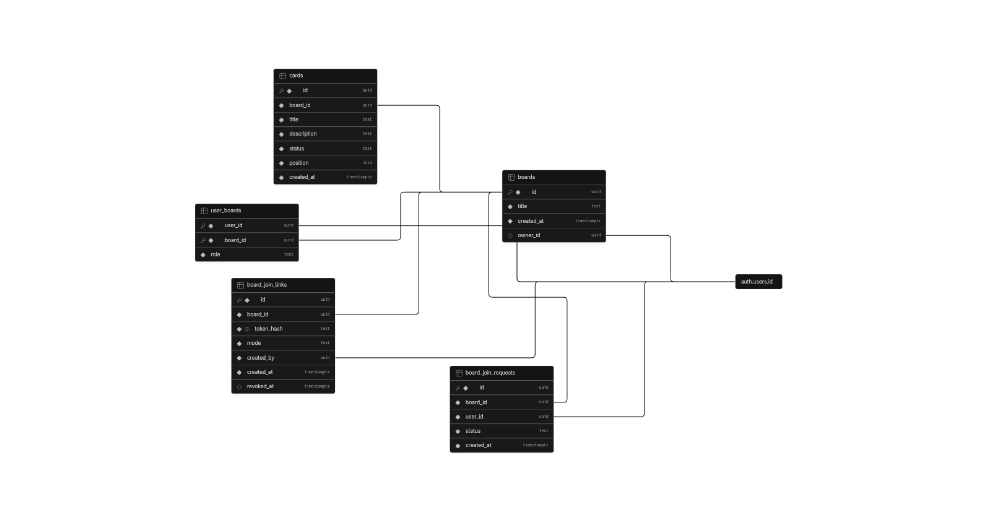

# Boardroom

**A lightweight Kanban workspace for teams.** Create boards, organize tasks into status lanes, manage access by role, and generate an AI summary of board progress.



*Database schema: boards, memberships, and tasks.*

## Features

- Email and password sign-in with Supabase Auth.
- Boards with **To do**, **In progress**, and **Done** task lanes.
- Create, edit, move, and delete cards. Dragging a card saves its status and order.
- Board roles: **owner**, **member**, and **viewer**. Owners manage access; members edit cards; viewers can read and request AI summaries.
- Revocable join links: anyone can join, or new members can request owner approval.
- Gemini board summaries, generated from card titles and statuses.
- Responsive workspace navigation.

## Architecture

```text
React + Vite (Vercel)
    │ Supabase session JWT
    ▼
Express API (Render) ─────── Gemini API
    │ per-user Supabase client
    ▼
Supabase Auth + Postgres with RLS
```

Postgres stores `boards`, `user_boards`, and `cards`. A board has many cards. `user_boards` links users to boards and stores each user's role. The API verifies each Supabase access token and applies role checks; database RLS policies restrict the same rows and operations.

## Local setup

### 1. Prepare Supabase

Create a Supabase project. In **SQL Editor**, run these files in order:

1. [`supabase/schema.sql`](supabase/schema.sql) — base tables and RLS.
2. [`supabase/rls_migration.sql`](supabase/rls_migration.sql) — board creation and member lookup helpers.
3. [`supabase/join_links.sql`](supabase/join_links.sql) — join links and approval requests.
4. [`supabase/rbac.sql`](supabase/rbac.sql) — owner role changes and member removal.

The base schema is for a fresh database. If you already created the previous schema, back up any data before changing tables; do not blindly rerun table creation SQL.

Enable email/password under **Authentication → Sign In / Providers**. Set the Supabase Auth **Site URL** to your frontend address and add its `/login` route to **Redirect URLs**.

### 2. Configure environment

Copy `server/.env.example` to `server/.env`. Set `SUPABASE_URL`, `SUPABASE_PUBLISHABLE_KEY`, and `GEMINI_API_KEY`. For local development, the example frontend URLs use Vite on port 5173.

Copy `client/.env.example` to `client/.env`. Set `VITE_SUPABASE_URL` and `VITE_SUPABASE_PUBLISHABLE_KEY`. `VITE_API_URL` defaults to the local API at `http://localhost:4000` in development.

Keep Gemini credentials in the server environment only. Variables prefixed with `VITE_` are included in the browser bundle and are public.

### 3. Install and run

From the repository root:

```bash
npm install
npm run dev
```

The frontend runs at `http://localhost:5173`; the API runs at `http://localhost:4000`. The API health check is `http://localhost:4000/health`.

## Deploy

### Vercel

Set these build environment variables in Vercel, then redeploy:

| Variable | Value |
| --- | --- |
| `VITE_API_URL` | Your Render service origin, e.g. `https://boardroom-api.onrender.com` (no `/api` suffix) |
| `VITE_SUPABASE_URL` | Supabase project URL |
| `VITE_SUPABASE_PUBLISHABLE_KEY` | Supabase publishable key |

### Render

Set these environment variables on the API service. `render.yaml` includes the service blueprint.

| Variable | Value |
| --- | --- |
| `SUPABASE_URL` | Same Supabase project used by Vercel |
| `SUPABASE_PUBLISHABLE_KEY` | Supabase publishable key; API requests also carry the user's JWT |
| `WEB_APP_URL` | Canonical Vercel origin, e.g. `https://your-app.vercel.app` |
| `CLIENT_ORIGIN` | Allowed frontend origins; comma-separate trusted staging/preview origins if needed |
| `GEMINI_API_KEY` | Gemini API key; keep server-side |
| `GEMINI_MODEL` | Optional; defaults to `gemini-3.8-flash` |
| `EMAIL_REDIRECT_URL` | Optional; defaults to `<WEB_APP_URL>/login` |
| `PORT` | Supplied by Render |

Set the Supabase Auth **Site URL** to `WEB_APP_URL` and add `<WEB_APP_URL>/login` to **Redirect URLs**. Redeploy Vercel after changing its variables and restart/redeploy Render after changing API variables.

## API overview

Authenticated API calls use `Authorization: Bearer <Supabase access token>`.

| Endpoint | Purpose |
| --- | --- |
| `GET /api/boards` | List boards for the signed-in user |
| `POST /api/boards` | Create a board and its owner membership |
| `GET /api/boards/:id` | Fetch board, tasks, role, and members |
| `POST /api/boards/:id/cards` | Create a task in a status lane |
| `PATCH /api/cards/:id` | Edit or move a task |
| `POST /api/boards/:id/summary` | Generate a Gemini summary |
| `/api/boards/:id/join-links` | Create/list owner-managed join links |
| `/api/boards/:id/join-requests` | Review pending access requests |

## Checks

```bash
npm run test -w server
npm run build -w client
```

The automated test currently covers join-link mode validation and token hashing. A live smoke test still requires a configured Supabase project and Gemini key.
